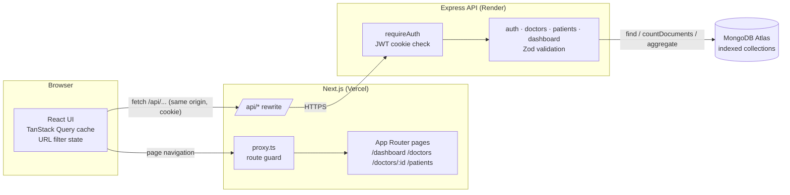
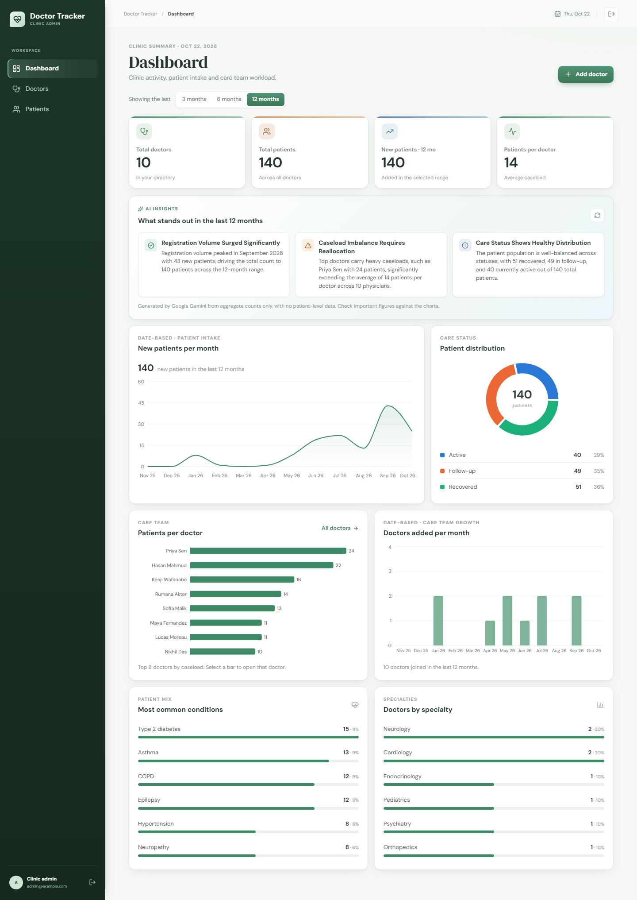
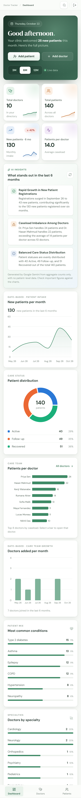
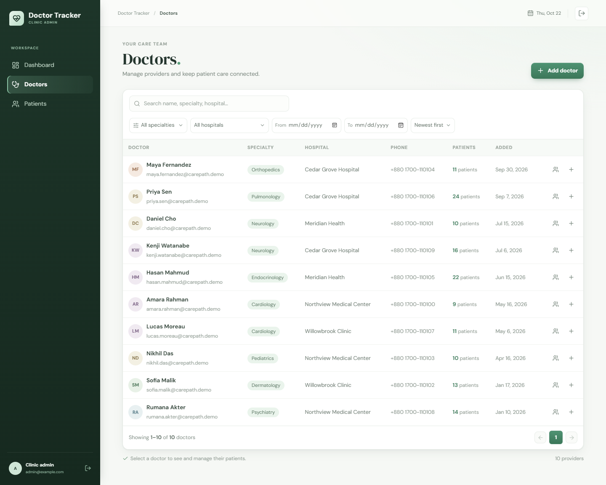
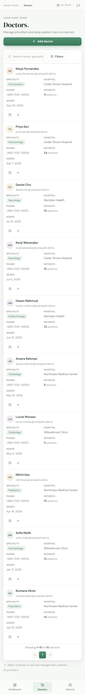
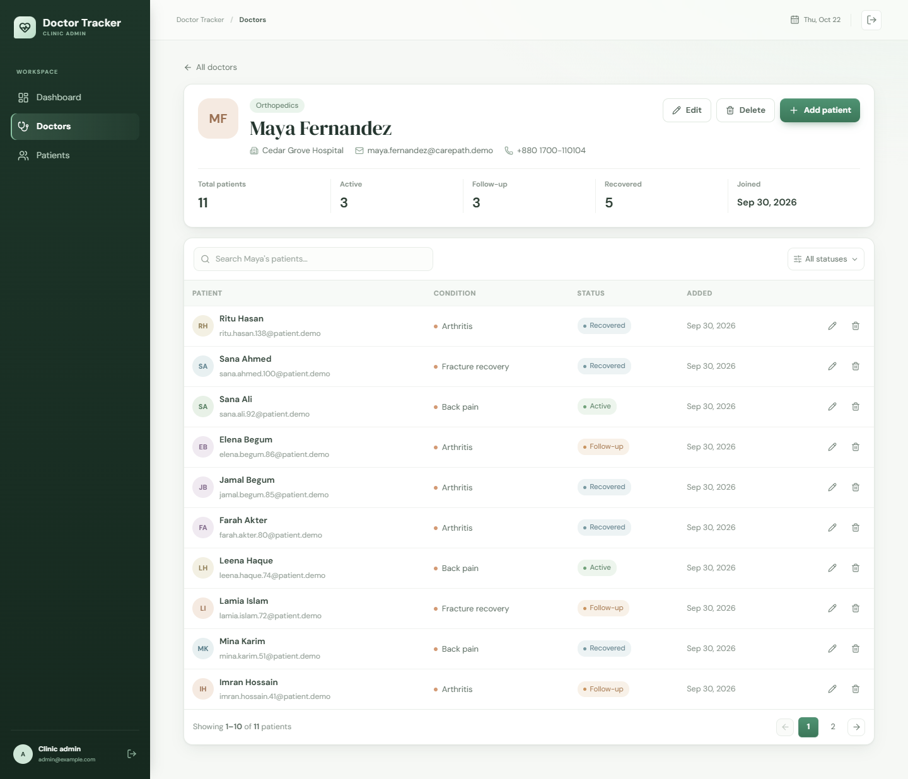
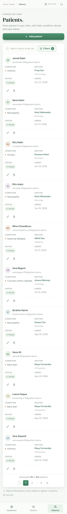
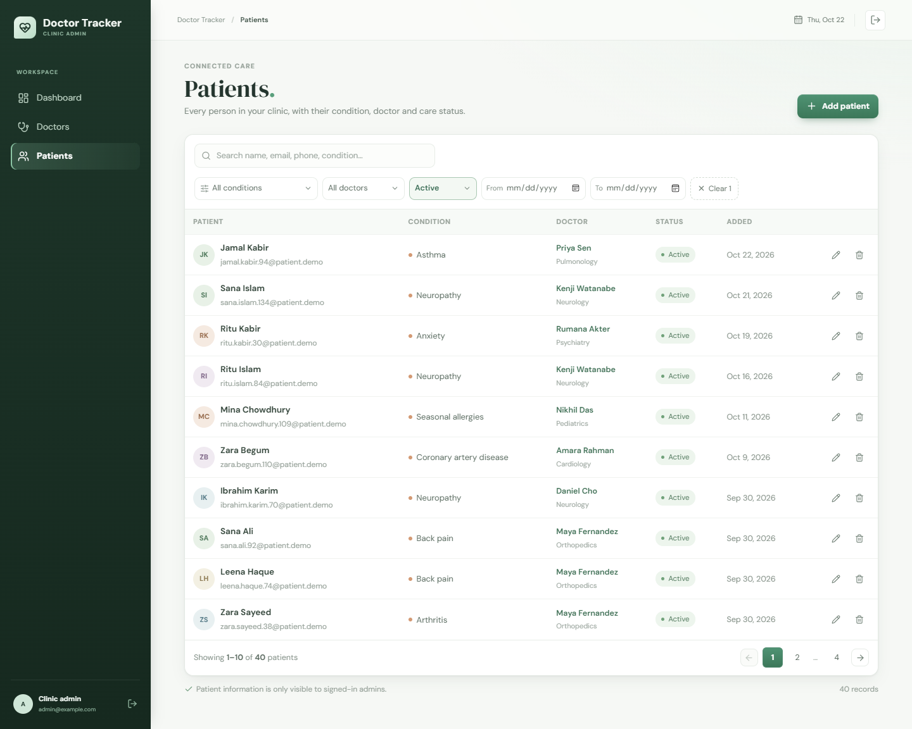
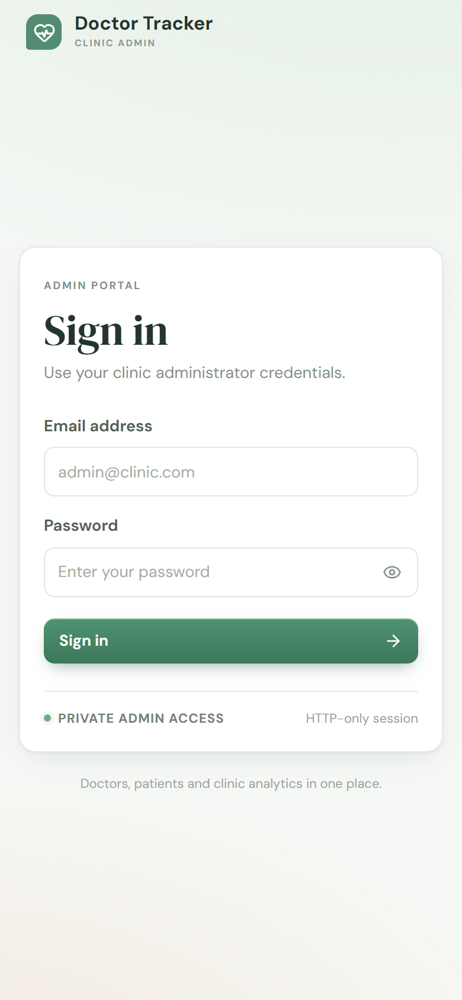

# Doctor Tracker

**Live demo:** https://doctor-tracker-frontend-wheat.vercel.app · **API:** https://doctor-tracker-backend-one.vercel.app · **Code:** [frontend](https://github.com/skbantu22/doctor-tracker-frontend) · [backend](https://github.com/skbantu22/doctor-tracker-backend)

Doctor Tracker is a secure admin workspace where clinic administrators manage doctors and their patients and can see how the clinic is changing. Admins sign in to a protected portal and keep a searchable, filterable directory of doctors. They can open any doctor to manage that doctor's patients, maintain the full patient register, and use a dashboard of totals, caseloads and month-by-month trends. The app is a Next.js client talking to a separate Express REST API backed by MongoDB. List views are paginated and indexed on the server, so they stay fast as records grow.

| | |
|---|---|
| **Frontend** | Next.js 16 (App Router), React 19, TanStack Query, Recharts, lucide icons |
| **Backend** | Node.js, Express 5, Mongoose 8, Zod, JWT (HTTP-only cookie), Helmet, express-rate-limit |
| **Database** | MongoDB (Atlas in production) |

## Features

- **Authentication.** There is a single admin account and no public sign-up. Sessions are a signed 8-hour JWT in an HTTP-only cookie. Every page is guarded by Next.js `proxy.ts`, and every API route verifies the token. Failed sign-ins are rate-limited.
- **Doctors.** Create, edit and delete doctors (name, specialization, hospital, phone, email). The directory has search, filters for specialty, hospital and date range, sorting and server-side pagination, with a patient count per doctor.
- **Doctor detail.** Each doctor's page shows their status breakdown and their paginated patient list, which can be searched and filtered. You can add patients under the doctor and remove patients from their list.
- **Patients.** A dedicated register with search, filters for condition, status, doctor and date range, pagination, edit and delete.
- **Dashboard.** Shows total doctors and total patients, new patients in the selected range, and average caseload. Charts cover new patients per month, doctors added per month, patients per doctor and care-status distribution, plus top conditions and specialties. The date range is selectable (3, 6 or 12 months). Every chart links into the filtered list behind it.
- **AI insights (optional).** When a free Google Gemini key is configured, the dashboard shows 3 or 4 plain-language insights, such as caseload imbalance, intake trends and status mix. They are generated on the server from aggregate counts only, with no patient-level data, and cached for 10 minutes. A second model is tried if the first is busy. Without a key, the card is simply hidden.
- **UX.** Filters live in the URL, so views can be shared, survive a refresh and work with the back button. Search is debounced. The previous page stays visible while the next one loads, and loading skeletons, empty states, error states with retry, confirmation dialogs and toasts are built in. On phones the sidebar becomes a bottom tab bar and tables become stacked cards.

## Setup Guide

Requirements: **Node.js 20+**, npm, and a MongoDB database (local `mongod`, Docker, or a free MongoDB Atlas cluster).

```bash
# 1. Clone both repositories side by side
git clone <backend-repo-url> backend
git clone <frontend-repo-url> frontend

# 2. Backend
cd backend
cp .env.example .env          # then edit the values (see below)
npm install
npm run seed                  # optional: 10 demo doctors + 140 demo patients spread over 12 months
npm run dev                   # http://localhost:4000  (health check: /api/health)

# 3. Frontend (new terminal)
cd frontend
cp .env.example .env.local    # API_SERVER_URL=http://localhost:4000
npm install
npm run dev                   # http://localhost:3000
```

Sign in with the `ADMIN_EMAIL` / `ADMIN_PASSWORD` you set in `backend/.env`.

**`backend/.env.example`**

| Variable | Purpose |
|---|---|
| `MONGODB_URI` | MongoDB connection string, e.g. `mongodb://127.0.0.1:27017/doctor_tracker` or an Atlas `mongodb+srv://…` URI |
| `JWT_SECRET` | Random string, at least 32 characters (`node -e "console.log(require('crypto').randomBytes(48).toString('hex'))"`) |
| `ADMIN_EMAIL` / `ADMIN_PASSWORD` | The admin login (password at least 12 characters) |
| `FRONTEND_URL` | Frontend origin, used for CORS |
| `PORT`, `NODE_ENV` | Defaults: `4000`, `development` |
| `GEMINI_API_KEY` | Optional. Free key from aistudio.google.com/apikey; enables AI dashboard insights |
| `GEMINI_MODEL` | Optional. Default `gemini-3.5-flash-lite` |

**`frontend/.env.example`**

| Variable | Purpose |
|---|---|
| `API_SERVER_URL` | Origin of the Express API. Next.js rewrites `/api/*` to it. |

Production checks: `npm run build` in both projects, and `npm run lint` in the frontend.

## System Architecture



**Request flow**

1. **Page request.** `proxy.ts` checks for the session cookie. Without it the visitor is redirected to `/login?next=…`, so the admin shell is never rendered for anonymous visitors.
2. **Data request.** Client components call `fetch('/api/…')` on their own origin. Next.js rewrites the call to the Express API, so the browser sees a single origin, the session cookie stays first-party and no CORS preflight is needed.
3. **API.** Helmet, a JSON body limit and the rate-limited login sit in front of `requireAuth`, which verifies the JWT on every data route. Inputs are validated with Zod, then MongoDB applies the filters, sorting, `skip` and `limit` using indexes. List responses include `{ data, pagination: { page, limit, total, pages } }`.
4. **Expired session.** A 401 from any data route sends the browser back to `/login`, which also discards the in-memory query cache.
5. **Writes.** A successful mutation invalidates the `doctors`, `patients` and `dashboard` query families, so every affected list, count and chart refreshes once.

**REST API**

| Method | Endpoint | Description |
|---|---|---|
| POST | `/api/auth/login` · `/api/auth/logout` | Start or end the session |
| GET | `/api/auth/me` | Current admin |
| GET | `/api/doctors?search&specialization&hospital&from&to&sort&page&limit` | Paginated directory with patient counts |
| GET | `/api/doctors/filters` | Distinct specialties and hospitals |
| POST | `/api/doctors` | Create a doctor |
| GET · PATCH · DELETE | `/api/doctors/:id` | Detail (with status breakdown), update, delete (refused while patients are assigned) |
| GET · POST | `/api/doctors/:id/patients?search&status&page&limit` | A doctor's patients; add a patient under the doctor |
| DELETE | `/api/doctors/:id/patients/:patientId` | Remove a patient from that doctor's list |
| GET | `/api/patients?search&condition&status&doctor&from&to&page&limit` | Paginated patient register |
| GET | `/api/patients/filters` | Distinct conditions and the doctor list |
| POST | `/api/patients` | Create a patient |
| PATCH · DELETE | `/api/patients/:id` | Edit or delete a patient |
| GET | `/api/dashboard/overview?months=3\|6\|12` | All dashboard aggregates in one round trip |
| GET | `/api/dashboard/insights?months=3\|6\|12` | AI insights from the same aggregates (503 when no Gemini key is set) |
| GET | `/api/health` | Liveness probe |

**Folder structure**

```text
backend/src
  config/env.ts        Zod-validated environment
  middleware/auth.ts   JWT cookie verification
  models/              Doctor, Patient schemas + indexes + keyword hooks
  routes/              auth, doctors, patients, dashboard
  services/insights.ts Gemini insights (aggregates only, cached, model fallback)
  utils/query.ts       pagination, date ranges, keyword search, HttpError
  seed.ts              idempotent demo data

frontend/src
  proxy.ts             route guard
  app/login            sign-in page
  app/(admin)/         dashboard, doctors, doctors/[id], patients (shared shell layout)
  components/ui        SearchField, SelectFilter, DateControl, PaginationBar, Modal, ConfirmDialog, Toast…
  components/{dashboard,doctors,patients,layout}
  hooks/               useUrlFilters, useDebouncedValue
  lib/                 api client, query hooks + keys, types, formatters
```

## Technical Decisions

### 1. TanStack Query + URL state instead of Redux or a Context store

Almost all state in this app is **server state**: doctor and patient pages, counts and aggregates owned by MongoDB. The only real client state is "which filters are applied". Neither Redux nor a hand-rolled Context store suits that split:

- With **Redux or Context**, we would hand-write loading, error and caching logic for every list, and also decide when to refetch after a write. A Context holding list data also re-renders every consumer whenever any of it changes.
- **TanStack Query** caches each request under a structured key, such as `["patients", "list", { status: "Active", page: 2 }]`.
  - Going back to a page you've already seen is instant.
  - `keepPreviousData` keeps the old rows on screen while the next page loads, so the table doesn't flash.
  - A mutation simply invalidates the `patients`, `doctors` and `dashboard` key prefixes.
  - Components subscribe only to the query they use, so typing in one page's search box doesn't re-render the others.
- **Filters live in the URL** (`useUrlFilters`), not in a store. Filtered views can be bookmarked and shared, survive a refresh, and work with the back button. The dashboard links straight into filtered lists (`/patients?condition=Asthma`). Changing a filter resets the page number.
- The search input keeps its own local state and only writes to the URL (and so the API) after a 300 ms pause. Typing stays responsive and sends one request per search instead of one per keystroke.

### 2. Indexed keyword-prefix search instead of case-insensitive regex

The obvious search implementation, `$or: [{ name: /^term/i }, { email: /^term/i }, …]`, can't use tight index bounds. A case-insensitive regex forces MongoDB to scan every key in the index or collection, and the `$or` repeats that scan for each field. That is fine for 100 records but not for 100,000.

Instead, each document stores a `keywords` array of lowercased tokens. Doctors get tokens from name, specialty, hospital and email. Patients get them from name, email, phone digits and condition. A Mongoose `pre("validate")` hook keeps the array up to date on every create and update, and older records are backfilled at startup.

The array has a multikey index (`{ keywords: 1 }`). Search lowercases the input, splits it into terms, and requires every term to match `{ keywords: /^term/ }`. That is a **case-sensitive anchored prefix regex**, which MongoDB turns into a bounded index range scan. As a result:

- "card nor" finds cardiologists at Northview.
- Partial words match ("rah" finds "Amara Rahman").
- Multiple filters and search combine in a single query.
- The field is `select: false`, so it never appears in API responses.

We considered two alternatives. A `$text` index doesn't do prefix matching, which matters for search-as-you-type. Atlas Search would tie the app to Atlas and adds infrastructure this scale doesn't need.

Supporting indexes on the other query paths:

- Doctors: `{ createdAt: -1, _id: -1 }`, `{ specialization: 1, createdAt: -1 }`, `{ hospital: 1, createdAt: -1 }`, unique `{ email: 1 }`.
- Patients: `{ createdAt: -1, _id: -1 }`, `{ doctor: 1, createdAt: -1 }`, `{ condition: 1, createdAt: -1 }`, `{ status: 1, createdAt: -1 }`.

List counts run in parallel with the page query (`Promise.all`). Patient counts for a page of doctors come from one `$group` over just those IDs, not a query per row. The dashboard is a single request running about seven parallel aggregations. Each is bounded with `$limit`, and the time series use the `createdAt` index through an early `$match`.

## Visual Evidence

| Desktop | Mobile |
|---|---|
|  |  |
|  |  |
|  |  |
|  |  |

## Deployment

**Backend on Render (free tier)**

1. Create a free MongoDB Atlas cluster.
   - Add a database user.
   - Under Network Access, allow `0.0.0.0/0`, because Render's free tier has no static IP.
   - Copy the `mongodb+srv://…` URI.
2. In Render, choose **New → Blueprint** and select the backend repo. `render.yaml` sets up the build, start command and health check.
   - Fill in `MONGODB_URI`, `ADMIN_EMAIL`, `ADMIN_PASSWORD` and `FRONTEND_URL`, plus `GEMINI_API_KEY` if you want AI insights.
   - `JWT_SECRET` is generated automatically.
3. Optionally, seed the demo data by running `MONGODB_URI=… npm run seed` locally against the Atlas URI.

**Frontend on Vercel**

1. Import the frontend repo.
2. Set the `API_SERVER_URL` environment variable to `https://<your-service>.onrender.com`.
3. Deploy. If you change `API_SERVER_URL` later, redeploy, because rewrites are resolved at build time.

Render's free instances go to sleep when idle, so the first request after a pause can take about 30–50 seconds.

## Scalability notes

- Pagination uses `skip` and `limit` with a page size capped at 100. For very deep pages, the same `{ createdAt, _id }` index supports cursor (keyset) pagination as a drop-in change.
- The API is stateless, since the session is a JWT, so it scales horizontally behind a load balancer.
- The dashboard runs aggregations on demand. At large volume, a scheduled job could write monthly rollups to a summary collection.
